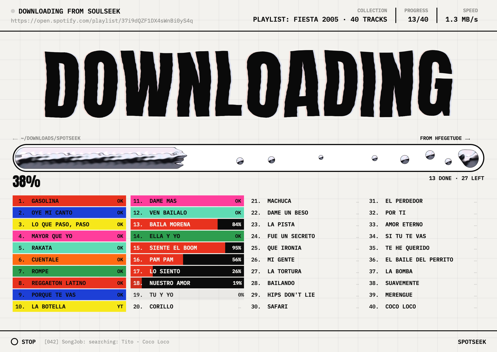

# Spotseek

A small desktop app that downloads music as mp3 files. Paste a public Spotify
**playlist**, **album**, or **track** link, or **search YouTube Music** and pick
a result. Tracks download from Soulseek first, the gaps are filled from YouTube
Music, and every file is normalized to mp3 at the bitrate you choose. FLAC is
never used.

The app opens one simple window: paste a link, watch it search and download,
then get a poster of the tracks. **CLASSIC WINDOW** (bottom right) opens the
older window with the YouTube Music search and the My Spotify library.



The official downloads bundle all the tools the app needs (sockseek, yt-dlp,
ffmpeg, ffprobe, and Deno). The only extra thing you need is a **Soulseek account** for
the Soulseek route.

## Install from the [GitHub releases page](https://github.com/lopezlav/spotseek/releases)

### macOS (Apple Silicon)

1. Download `Spotseek-macOS-arm64.zip` from the latest release.
2. Unzip it and drag **Spotseek** into `/Applications`.
3. The app is not notarized by Apple. If macOS blocks the first start, use
   **System Settings → Privacy & Security → Open Anyway**, or run this once:
   ```bash
   xattr -dr com.apple.quarantine /Applications/Spotseek.app
   ```

The download is for Apple Silicon Macs (M1 and newer). On an Intel Mac,
install the tools with Homebrew and build from source (see below).

### Windows

1. Download `Spotseek-Setup-<version>.exe` from the latest release.
2. Run it and follow the setup steps. The tools are installed with the app,
   in the `bin` folder next to the program.

Windows may show a blue SmartScreen warning because the app is not signed.
Choose **More info**, then **Run anyway**.

### Linux (x64)

1. Download `Spotseek-linux-x64.tar.gz` from the latest release.
2. Unpack it and run the install script:
   ```bash
   tar -xzf Spotseek-linux-x64.tar.gz
   ./Spotseek/install.sh
   ```
   This puts Spotseek in your app menu and adds a `spotseek` command
   (`~/.local/share/spotseek`). Or run `./Spotseek/spotseek` without installing.
   `~/.local/share/spotseek/install.sh --uninstall` removes it.

All tools are included. The system needs what a desktop normally has: a
graphics driver (Vulkan or OpenGL), ALSA, D-Bus with a secret service (GNOME
Keyring or KWallet) for the Soulseek password, and ICU. Built on Ubuntu 22.04.

## Soulseek account

Downloads try Soulseek first, through the bundled sockseek tool. Soulseek
needs an account:

1. Install the free [Soulseek](https://www.slsknet.org/news/) client or
   [Nicotine+](https://nicotine-plus.org/) once and create an account.
2. In Spotseek, open **Download**, open the **Soulseek account** section, and
   type your username and password.

You do not need the official Soulseek app after that; sockseek does the
downloading. Without an account, every track falls back to YouTube Music, and
the **YouTube** tab works without any account at all.

## Requirements

Nothing must be installed when you use the official downloads. If you build
the app yourself, these tools must be on the machine, because the self-built
app has no bundled copies:

- **Sockseek** - the Soulseek downloader. A Soulseek account must be set in
  `~/.config/sockseek/sockseek.conf` (or typed in the app).
- **yt-dlp** - for the YouTube Music search and fallback.
- **ffmpeg** and **ffprobe** - for the mp3 normalization.
- **Deno** - JavaScript runtime needed by yt-dlp for full YouTube support.

On macOS:

```bash
brew install yt-dlp ffmpeg deno
# Sockseek: download a release, or build the sockseek repo
```

## Search YouTube Music (no account)

Open **CLASSIC WINDOW** from the bottom right of the app. Its **YouTube** tab searches YouTube Music directly. Type a song, an artist,
or a few words from the title, press **Search**, and download the result you
pick. Nothing is read from Spotify and no account is needed.

## The app window (Rune UI)

The window is `ui/`, written in Rust with [Rune](https://github.com/anomalyco/rune).
It does no downloading itself: it runs the Go program as its backend,
`spotseek-backend --cli <url> -o <dir> --events --ask`. The backend writes one
JSON event per line (see `internal/pipeline/events.go`) and stops when its stdin
closes. With `--ask`, it waits after the track list for one stdin line,
`{"only":[0,2,5]}`, and downloads only those tracks. The window looks for `spotseek-backend` next to its own program; set
`SPOTSEEK_BACKEND` to use another path.

- The headline and the liquid-metal progress bar are our own shader
  (`ui/src/liquid.wgsl`) at Rune effect slots. The headline words are signed
  distance fields (`ui/src/sdf.rs`), so one word can flow into the next.
- At launch, the window asks for a Soulseek account until there is one (it can be skipped:
  then everything comes from YouTube Music). Soulseek has no sign-up page; signing in with a new
  name creates the account, as Nicotine+ does. `spotseek-backend --cli --check-login --user NAME`
  (password on stdin) signs in once and prints `{"ok":…}`. The password is kept in the macOS
  Keychain or the Windows Credential Manager; an account in `sockseek.conf` also works.
- The texts are in English and Spanish, by the system language (`SPOTSEEK_LANG=es` to test).
- Click a track to open its details: cover, source, peer, quality, size,
  average speed, time, and a player (space plays and pauses).
- Tracks that are already in the output folder (from the history, or by their
  mp3 tags) are not downloaded again. The window asks "download again" or
  "skip" next to each one. With no answer, they are skipped when nothing else
  is left, after a countdown that only runs while the window has focus.
- Everything is in the user's config folder (`~/Library/Application
  Support/Spotseek` on macOS, `%APPDATA%\Spotseek` on Windows):
  `settings.json`, `history.json` (every download, by link), `covers/`, and
  `logs/` (each backend run, line by line; the last 40 are kept). The Soulseek
  password is never saved. `SPOTSEEK_CONFIG_DIR` sets another folder.

Development helpers:

```bash
cd ui
cargo test --release
# Render one screen headless (see --list-scenes: downloading, details, have, history, …)
cargo run --release -- --snap out.png --scene downloading --size 1100x780 --scale 2
# A scripted download with no backend and no network, recorded as video
SPOTSEEK_DEMO=1 cargo run --release -- --script scripts/demo.json --video demo.mp4 --size 1100x780
```

## Build on macOS

Rust (stable), Go, and the Xcode command line tools are needed.

```bash
ui/package-mac.sh            # builds ui/target/Spotseek.app
ui/package-mac.sh --install  # also replaces /Applications/Spotseek.app (old app to the Trash)
```

To bundle the tools into the .app (Python 3 is needed on the build machine
only; also copy a self-contained sockseek build into `build/bin`), run this
before `package-mac.sh`:

```bash
scripts/fetch-tools.sh build/bin darwin-arm64
```

## Build on Windows

Fyne uses cgo and OpenGL, so a Windows `.exe` **cannot be cross-compiled from
macOS**. Build it on a Windows machine:

1. Install Go, a C compiler (MSYS2 mingw-w64 gcc, or TDM-GCC), and Rust
   (stable, MSVC toolchain).
2. Install the tools:
   - Sockseek (Windows release)
   - `yt-dlp.exe`
   - ffmpeg (add `ffmpeg.exe` and `ffprobe.exe` to PATH)
3. Build the backend and the window, and put them in one folder:
    ```bat
    go build -o spotseek-backend.exe .
    cd ui && cargo build --release
    copy target\release\spotseek.exe ..\Spotseek.exe
    ```
    Keep `spotseek-backend.exe` next to `Spotseek.exe`.

The code already handles Windows: the startup `PATH` fix adds the WinGet and
scoop folders, and **Open folder** uses `explorer`. Release builds test silent installation, tool startup, MP3 encoding, and
uninstallation on a Windows runner. Interactive desktop use still needs a
human check.

## Releases

GitHub Actions builds the downloads whenever a tag like `v1.2.3` is pushed:

- `Spotseek-macOS-arm64.zip` - the .app with all tools bundled.
- `Spotseek-Setup-<version>.exe` - the Windows installer with all tools bundled.
- `Spotseek-linux-x64.tar.gz` - the Linux app with all tools bundled and an install script.

Both contain the app window (the Rune UI, `Spotseek.app/Contents/MacOS/spotseek`
or `Spotseek.exe`) and the Go backend next to it (`spotseek-backend`).

The workflow also runs manually from the Actions tab and uploads the same
files as build artifacts. Both platform builds, tests, and smoke tests must
pass before a **draft** release is created, with `SHA256SUMS.txt`. Publish the
draft from the releases page after checking the downloads.

```bash
gh workflow run release.yml --ref main -f version=0.1.0
# Build, verify, and prepare a draft from the selected commit:
gh workflow run release.yml --ref main -f version=0.1.0 -f draft_release=true
# Alternatively, pushing a v0.1.0 tag also builds a draft.
```

The workflow pins sockseek to a source commit. Downloaded tools are pinned by
version and SHA-256 in `packaging/tools.json`; changing a tool requires updating
its checksum and testing a new manual build. CI also runs tests and vet on
macOS and Windows for pushes and pull requests, for the Go code and for the
app window.

Spotseek's own code is licensed under [MIT](LICENSE).
See [third-party notices](THIRD_PARTY_NOTICES.md) for bundled licenses and
source references. These are also included inside both installers.

## Connect Spotify (read-only)

The **My Spotify** tab shows your playlists, albums, and liked songs, and
downloads them with one click. This uses the official Spotify API, read-only.

Setup, once:

1. Open https://developer.spotify.com/dashboard and create an app.
2. In the app settings, add this exact Redirect URI:
   `http://127.0.0.1:48721/callback`
   (`localhost` is not allowed by Spotify; the loopback IP is.)
3. Copy the **Client ID** (no secret is needed; the app uses PKCE).
4. In the app, open **My Spotify**, paste the Client ID, and click
   **Connect Spotify**.
5. Log in in the browser. The app saves only a refresh token, in the macOS
   Keychain (Windows Credential Manager on Windows).

Scopes requested, all read-only:
`playlist-read-private playlist-read-collaborative user-library-read user-read-private`.
The app never writes to your Spotify account.

Spotify requires the owner of the developer app to have Premium. This is a
Spotify rule, not an app setting.

## Command line (for testing)

```bash
Spotseek.app/Contents/MacOS/spotseek-backend --cli "<spotify-url>" -o <dir>
```

Options: `--bitrate 320`, `--no-fallback`, `--limit N`, `--extract-only`,
`--events` (JSON events on stdout, used by the app window), `--user NAME --pass-stdin`.

Add `--timings` to log JSON `TIMING` records and include stage durations in
`_report.json`. Server downloads record these timings in each job's log.
Durations cover Soulseek process startup/login, search and peer selection,
transfer attempts, missing-file checks, both YouTube searches, candidate
metadata and ranking, each yt-dlp retry, audio transfer, MP3 encoding,
metadata/thumbnail processing, and final probing/copying/transcoding.
Parent totals include their child stages; do not add both together.
Soulseek and yt-dlp subprocess stages use observed output boundaries, so a
transfer interval can include connection or queue time. First-progress time
is recorded when progress can be attributed to a track.

For repeated, isolated measurements of several tracks, save a JSON array
containing `id`, `artist`, `title`, and `duration` (seconds), then run:

```bash
go run ./cmd/download-bench --tracks tracks.json --out /tmp/spotseek-bench-new --repeat 3
```

The output directory must be new. Each trial gets its own work and audio
folders, a timestamped `timeline.log`, and a `result.json`. `results.json`
collects completed trials even if a later trial is interrupted. Downloads
run sequentially using the configured bitrate, executables, credentials,
matching threshold, and Soulseek deadline. Supplied metadata models server
downloads; use `--fetch-metadata` to include public Spotify page extraction.
`--mode direct-youtube` skips Soulseek as an explicitly forced control;
`--mode both` runs both routes. Automatic runs retain the real fallback rules.

Fallback search reads structured results and discards channel/album browse
entries. YouTube Music and YouTube searches run together. Full metadata is
checked in groups of three, with at most four search processes across jobs.
Flat metadata chooses the initial shortlist; final scoring still uses full
metadata. More candidates are checked unless the best score reaches the
matcher's maximum (12); earlier entries are still checked to preserve ties.
Metadata checks retain a shared 180-second deadline.

For server jobs and single-track CLI runs, fallback search starts alongside
Soulseek. YouTube audio is downloaded only after Soulseek misses the track.
Pending speculative search is canceled when Soulseek succeeds or the job is
canceled. Multi-track CLI and album runs search YouTube only for missing tracks.
Timing spans can overlap; pipeline elapsed time measures the real wall time.

<!-- AI-assisted documentation begins. -->
## Mixxx server and catalogue search

The Mixxx progressive-download prototype uses `POST /api/v1/downloads/prepare`
with one track's metadata to prepare a drag without downloading audio.
`POST /api/v1/downloads` accepts `progressive: true` to expose a stable playback
descriptor, buffered duration, completion, and decoder errors in job snapshots.
Soulseek transfers decode to append-only PCM while the final MP3 is processed
separately. YouTube fallback loads after completion. See the Mixxx fork's
`docs/progressive-downloads.md` for behavior and prototype limitations.

Run `spotseek-app serve` to start the local service on `127.0.0.1:8765`.
The Mixxx Spotify feature uses the service for login, metadata, file lookup,
and downloads. The service does not open the Mixxx database.

- `GET /api/v1/catalog/search?q=...&type=track|album|artist&offset=...`
  returns one page of up to 10 results and `next_offset`. An offset of `-1`
  means there are no more results. Set `refresh=1` to fetch again.
- `GET /api/v1/catalog/downloaded` returns all saved completed assets for the
  active account. Each asset has track metadata, a file path, and its update time.

`internal/spotify/catalog.go` defines typed search requests, result pages, and
safe Spotify API errors. `internal/server/catalog.go` separates catalogue reads
from saved-library sync. Its cache holds up to 128 pages for five minutes and
keeps accounts separate. A canceled HTTP search cancels the Spotify read. A
rate limit returns `code: rate_limited`, a retry time, and the `Retry-After`
header. Login, access, and timeout errors have short messages.

The service saves completed assets in `.spotseek/jobs.json`. Assets stay after
old job records are removed. Existing successful jobs migrate at startup.
A failed retry does not remove a completed asset. Search downloads go into the
`Search` folder under the configured music folder. Other downloads keep their
collection folder. Mixxx builds its Downloaded list from these assets and local
links, so the list can open without the server.

Checks: `go test ./...`, `go vet ./...`, and
`go test -race ./internal/server ./internal/spotify ./internal/libraryindex`.
<!-- AI-assisted documentation ends. -->

## Layout

- `internal/spotify` - reads playlist, album, and track metadata from public
  Spotify pages. No login or developer app needed.
- `internal/ytdlp` - YouTube Music search, ranking, and download.
- `internal/pipeline` - runs Sockseek, finds missing tracks, runs the fallback,
  and normalizes to mp3.
- `scripts` - downloads the bundled tools for packaging.
- `packaging/windows` - the Inno Setup script for the Windows installer.
- `main.go` - the classic Fyne window, the CLI mode, and the server.
- `ui` - the app window (Rust, Rune).
